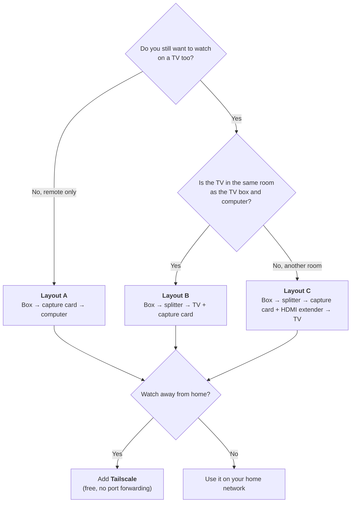
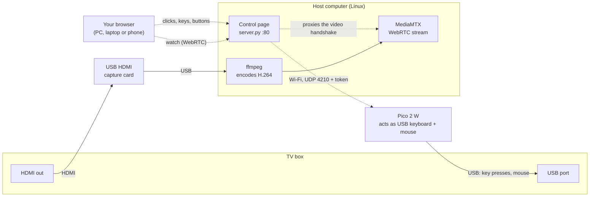
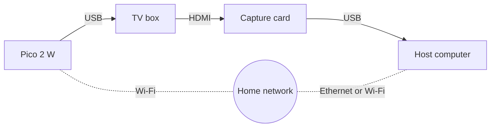
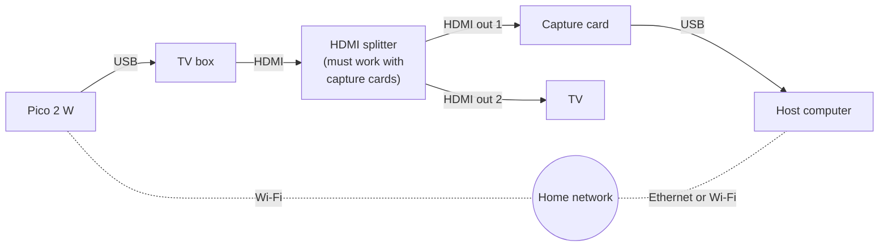
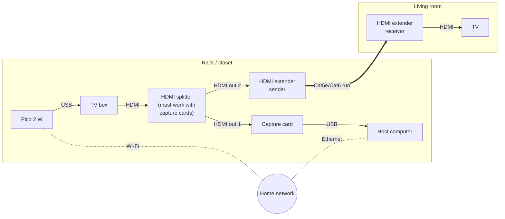
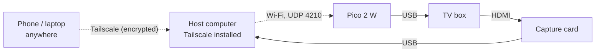
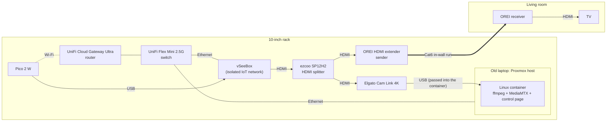

# Diagrams

GitHub draws these automatically. Solid lines are cables; dashed lines are network or Wi-Fi.

## Which layout do I need?

## How it works (any layout)

The browser only talks to the host. The host passes commands to the Pico with a token the browser never sees.

## Layout A: remote only (no TV)

## Layout B: TV in the same room

## Layout C: TV in another room

**Don't use the extender's loop-out port to feed the capture card.** It passes the copy protection (HDCP)
straight through, and the capture card shows black. The splitter goes first in the chain.

## Watching away from home (Tailscale)

No ports are opened on the router. **Never** port-forward the control page: anyone who can open it controls the
box.

## Reference build (the original home lab)

Overkill for most people, but it shows how it fits into a home lab. Layout C on a Proxmox server.

