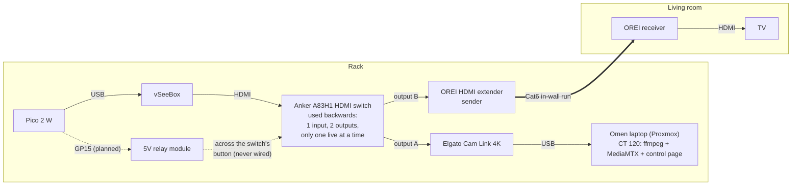

# Old setup: Anker HDMI switch (retired Nov 2, 2026)

Kept for history. This was the working reference build from Oct 31 to Nov 2, 2026, before the ezcoo SP12H2
splitter replaced the switch. **Don't build this one.** Use a splitter (see [SETUP.md](../SETUP.md)). The reasons
are in [HISTORY.md](../HISTORY.md#keeping-the-tv-working-switch-then-splitter).

## How it was wired

- The switch gave the Cam Link a picture it accepted, which the OREI extender's loop-out did not (HDCP, see
  HISTORY.md).
- **Catch:** only one output was live at a time. Watching on the TV or on the stream meant pressing the switch's
  button to flip outputs.
- **The relay plan:** the Pico would "press" that button through a relay on GP15. The relay was wired to the Pico
  and clicked from the control page's **Switch HDMI** button (`sw` command), but it was never soldered across the
  Anker's button: the case has no visible screws, and the splitter made it unnecessary.

## Parts list (at the time)

| Part | Role | Status now |
|---|---|---|
| Raspberry Pi Pico 2 W | USB keyboard + mouse in the vSeeBox | Still used |
| Elgato Cam Link 4K ($99.99, Micro Center, Oct 2026) | HDMI capture | Still used |
| OREI HDMI-over-Cat extender (sender + receiver) | Picture to the living room TV | Still used |
| Anker A83H1 HDMI switch | Fed the capture card and the TV, one at a time | **Retired** |
| 5V relay module (G / V / S pins; S → GP15, active high, 250 ms pulse) | Would press the switch button | **Retired** |
| Arduino Nano ESP32 | First USB keyboard/mouse attempt | Retired earlier (see HISTORY.md) |
| HDMI cables | box → switch, switch → Cam Link, switch → OREI sender, OREI receiver → TV | Same four cables now go through the splitter |

## What's left of it in the code

- Firmware: the `sw [ms]` command and the relay settings on `/setup` still exist. They're harmless and could
  drive a relay for anyone who does need to press a button.
- Control page: the **Switch HDMI** button was removed when the splitter went in. `server.py` still allows `sw`.
